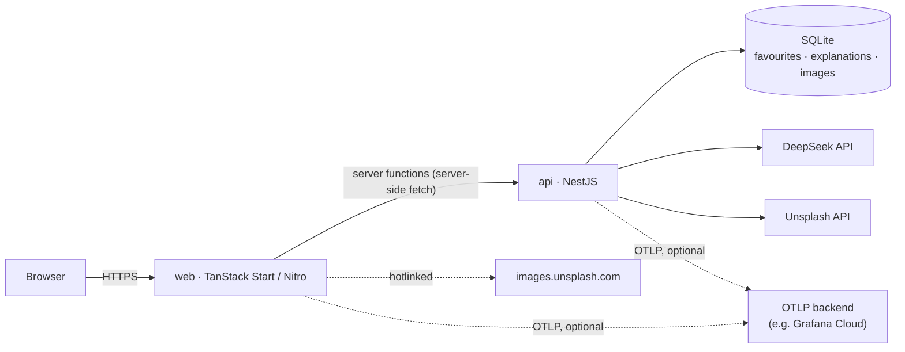
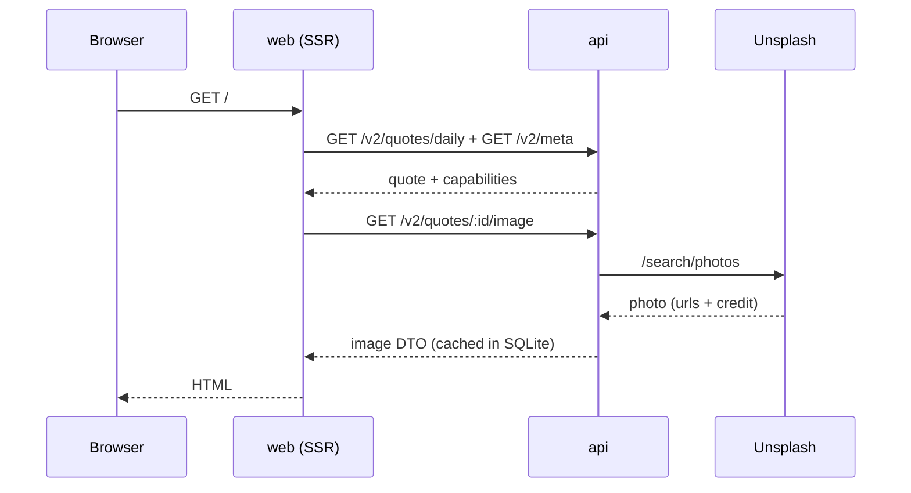
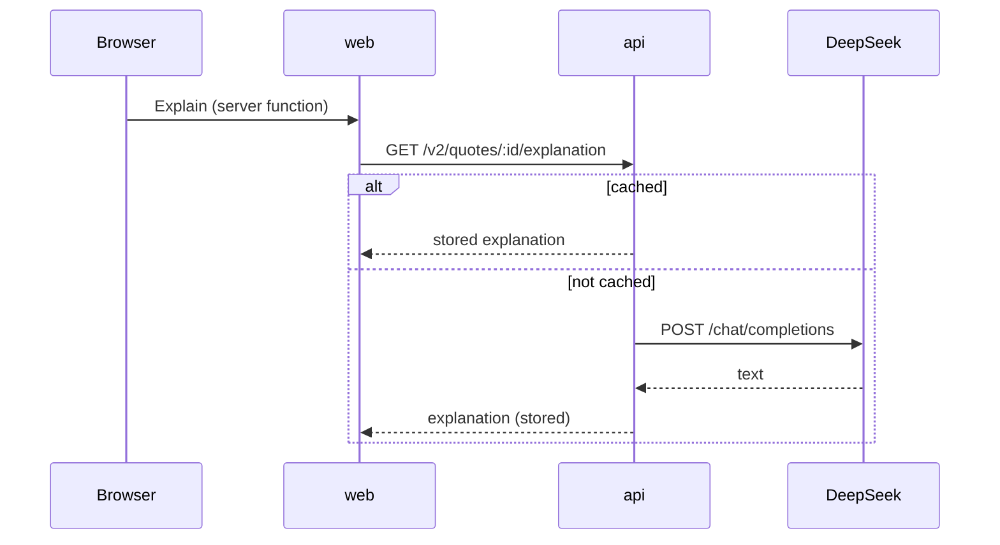

# Architecture

Stoic Quote is a small, deliberately boring system: a JSON dataset of
public-domain quotes, a stateless read API around it, a server-rendered site,
and one optional piece of mutable state (per-visitor favourites) in SQLite.

- `apps/api` — NestJS API (CommonJS, Node ≥ 22).
- `apps/web` — TanStack Start site (React 19, Vite, Nitro, ESM).
- `k3s/` — production manifests; `k3s/dev/` is a single-node dev overlay.
- `.github/workflows/main.yaml`, `.gitlab-ci.yml` — CI/CD.
- `apps/api/scripts/extract.mjs` — deterministic dataset generator.

See [README.md](../README.md) for setup, commands and the environment table.

## System context

The browser never talks to the API directly: the API base URL and any API keys
stay on the web server, and every call goes through TanStack Start **server
functions**.

## Repository layout

| Path | Contents |
| --- | --- |
| `apps/api/src` | NestJS modules, controllers, services, SQLite access |
| `apps/api/data/quotes.json` | Generated, committed dataset |
| `apps/api/scripts/extract.mjs` | Dataset extractor (reads the submodules) |
| `apps/api/test` | Jest unit/e2e tests + fixture dataset |
| `apps/web/src/routes` | File-based pages (`/`, `/q/$id`, `/favourites`) |
| `apps/web/src/lib` | API client, server functions, visitor id, logger/OTel |
| `apps/web/src/server.ts` | Custom Start server entry (OTel init) |
| `k3s`, `k3s/dev` | Kubernetes manifests |
| `bin/dev-deploy.sh` | Build → import into k3s → roll out the dev overlay |

## API (`apps/api`)

NestJS with a global SQLite module and small feature modules.

| Module | Responsibility |
| --- | --- |
| `DatabaseModule` (`@Global`) | Opens `better-sqlite3`, creates tables, closes on shutdown |
| `DatasetModule` | Loads and validates `quotes.json` once at boot |
| `QuotesModule` | `random`, `daily`, `byId` |
| `ExplainModule` | DeepSeek explanations, cached in SQLite |
| `ImagesModule` | Unsplash search, cached in SQLite |
| `FavouritesModule` | Anonymous per-visitor favourites |
| `MetaModule` | `/v2/meta`, `/health` |
| `LoggerModule` | `nestjs-pino` request logging (see Observability) |

### Dataset

`DatasetService` reads `DATA_DIR/quotes.json` at construction, validates its
shape, and indexes it by id in a `Map`. Random selection filters in memory;
`daily` picks a stable index from an FNV-1a hash of the date, so the same date
always yields the same quote. The dataset is immutable at runtime.

### Storage

SQLite (`SQLITE_PATH`, default `./.data/stoic.db`) holds the only mutable state.
`DatabaseModule` creates the schema on boot:

| Table | Key | Purpose |
| --- | --- | --- |
| `favourites` | `(visitor_id, quote_id)` | Saved quotes per anonymous visitor |
| `explanations` | `quote_id` | DeepSeek output keyed by `(model, prompt_version)` |
| `images` | `quote_id` | Chosen Unsplash photo + derived URLs |

`better-sqlite3` is synchronous and does not coordinate across processes, which
is why the API runs as a single writer (see Deployment).

### Endpoints

| Method / path | Notes |
| --- | --- |
| `GET /v2/meta` | Quote count, `capabilities.explain/images`, work slugs |
| `GET /health` | Liveness/readiness target |
| `GET /v2/quotes/random` | Filters: `tag`, `work`, `minLength`, `maxLength` |
| `GET /v2/quotes/daily` | `?date=YYYY-MM-DD`, deterministic |
| `GET /v2/quotes/:id` | Single quote |
| `GET /v2/quotes/:id/explanation` | 503 if `DEEPSEEK_API_KEY` unset |
| `GET /v2/quotes/:id/image` | 404 if `UNSPLASH_ACCESS_KEY` unset |
| `GET\|POST\|DELETE /v2/favourites` | Requires `x-visitor-id` (8–64 `[A-Za-z0-9_-]`) |
| `GET /`, `/aurelius`, `/seneca`, `/epictetus-*` | Frozen v1 plain-text endpoints |

Swagger is served at `/api-doc`. The v1 routes are intentionally frozen for
existing consumers; `min`/`max` on `/` keep the original `>100` validation and
417 behaviour.

### External integrations

- **DeepSeek** (`explain.service.ts`): POST `/chat/completions` with a fixed
  system prompt, 30s timeout, one retry. Results are cached by
  `(quote_id, model, prompt_version)`, so bumping `PROMPT_VERSION` regenerates
  explanations without manual cache busting.
- **Unsplash** (`images.service.ts`): `GET /search/photos`, `content_filter=high`,
  landscape, one result. The quote's first tag maps to a curated query
  (`tag-queries.ts`). The response is stored in SQLite; derived sizes
  (`1600`, `480`, `1200×630`) are hotlinked from `images.unsplash.com` with
  photographer credit, per Unsplash's guidelines.

Both integrations degrade gracefully: with no key the feature is reported as
unavailable in `/v2/meta`, and the corresponding endpoint returns 404/503.

## Web (`apps/web`)

TanStack Start: file-based routing, SSR route loaders, and server functions.

| Route | Purpose |
| --- | --- |
| `/` | Daily quote + "New quote" random fetch |
| `/q/$id` | Shareable quote deep link (OG image from the quote's photo) |
| `/favourites` | The visitor's saved quotes |

- `src/lib/api.ts` is **server-only** and the single place the API is called
  (`fetch` with a 10s timeout). Every call is wrapped by a `createServerFn` in
  `src/lib/functions.ts`, which the routes and components invoke.
- Route loaders (`src/routes/index.tsx`, `q.$id.tsx`) fetch on the server during
  SSR; interactive actions (New quote, Explain, Save, Share) call server
  functions from the client.
- **Visitor identity** (`src/lib/visitor.ts`) is a random UUID in
  `localStorage`, sent only as the `x-visitor-id` header through server
  functions — the browser never sends it to the API directly.
- Styling is Tailwind CSS v4 (`src/styles.css`); `src/routeTree.gen.ts` is
  generated by the Vite plugin and committed.

## Observability

Both apps emit structured JSON logs via **pino** and export
**OpenTelemetry** traces and logs over OTLP. Everything is **opt-in**: without
`OTEL_EXPORTER_OTLP_ENDPOINT`, the SDK is a no-op and no exporter is started.

| Concern | API | Web |
| --- | --- | --- |
| Bootstrap | `src/otel.ts`, imported first in `main.ts` | `src/lib/otel.server.ts`, imported by `src/server.ts` |
| Logging | `nestjs-pino` (`src/logger.config.ts`) | `src/lib/logger.server.ts` |
| Service name | `stoic-quote-api` | `stoic-quote-web` |

Instrumentations: `@opentelemetry/instrumentation-http` (inbound server spans),
`instrumentation-undici` (outbound `fetch`, including DeepSeek/Unsplash and
web→api), and `instrumentation-pino` (trace context on log lines + log records).

Correlation: the web client span injects a W3C `traceparent` header; the API's
HTTP instrumentation continues that trace, so a single user action is one trace
across web → api → external calls, and every pino line carries
`trace_id`/`span_id`.

Redaction: `x-visitor-id`, `authorization` and `cookie` headers are removed from
logs; request/response bodies and DeepSeek prompts are never logged.

## Request flows

Daily quote (SSR):

Explanation (on demand, cached):

## Data pipeline

`apps/api/scripts/extract.mjs` reads the four Standard Ebooks submodules, parses
the XHTML, filters quotes to 100–700 characters, assigns stable ids, and tags
each quote from a keyword vocabulary. The output is committed at
`apps/api/data/quotes.json` (~7.9k quotes). CI re-runs the extractor and fails
the build if the committed file differs (`git diff --exit-code apps/api/data`).

## Build, test, CI

Turbo tasks (`turbo.json`): `build`, `dev`, `lint`, `check-types`, `test`.

- `pnpm test` → Jest unit tests in `apps/api` (fixture dataset, no network).
- `pnpm check-types` → `tsc --noEmit` in both apps.
- `pnpm extract` → regenerate the dataset.

GitHub Actions (`.github/workflows/main.yaml`) and GitLab CI
(`.gitlab-ci.yml`) run the same pipeline: **verify** (build, test, dataset
freshness) → **docker** (matrix `api`/`web`, push images tagged with the commit
SHA) → **deploy** (`kubectl apply -f k3s/`, pin images to the SHA, wait for
rollouts). Both run deploy only on the default branch.

## Deployment

- **Local**: `docker-compose.yml` builds both images from the repo root (shared
  pnpm workspace), mounts a bind volume for the API's SQLite file.
- **k3s production** (`k3s/`): namespace `stoic-quote`; API is a single
  `Recreate` replica with a `local-path` PVC at `/data` (SQLite is a single
  writer on a `ReadWriteOnce` volume); web runs 2→6 replicas behind an HPA with
  a PDB; Traefik ingress routes `stoic.jktlug.id` → web and
  `api.stoic.jktlug.id` → api (TLS block ready for cert-manager).
- **k3s dev** (`k3s/dev/`): same stack in `stoic-quote-dev`, one replica each,
  `emptyDir` instead of a PVC, images imported locally by `bin/dev-deploy.sh`.
- Secrets: `stoic-quote-secrets` holds `DEEPSEEK_*`, `UNSPLASH_ACCESS_KEY` and
  the optional `OTEL_*` keys; every reference is `optional: true`, so pods start
  even before the secret exists.

## Design decisions and trade-offs

- **SQLite, single writer.** Favourites and the two caches need persistence but
  no horizontal scale; one `Recreate` pod avoids cross-process SQLite problems.
- **Hotlinked Unsplash images.** Required by Unsplash's API guidelines and
  reported as photographer views; only metadata is cached, never image bytes.
- **Frozen v1 endpoints.** Kept byte-compatible for existing consumers while v2
  carries stable ids, tags and attribution.
- **Opt-in, vendor-neutral telemetry.** OTLP with no in-cluster collector keeps
  the single-node cluster light and the backend swappable; unset env means zero
  overhead.
- **Server-only API access.** Keeps the access key off the client and satisfies
  Unsplash's key-confidentiality guideline.
